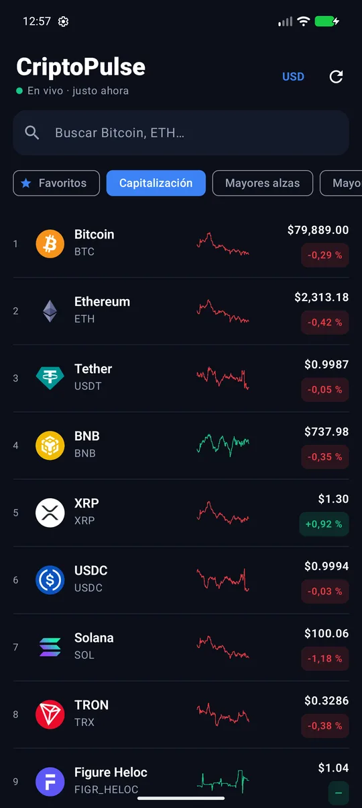
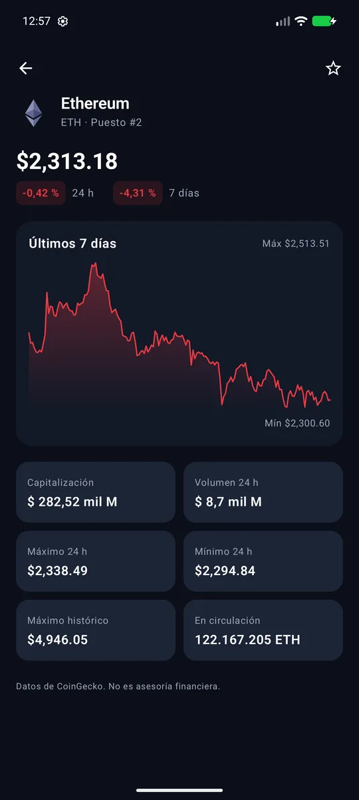
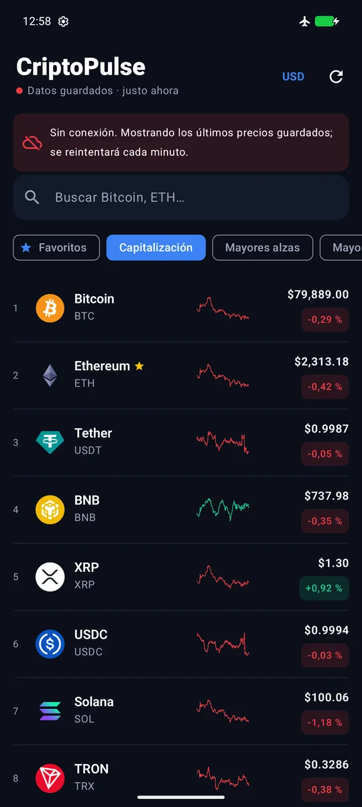
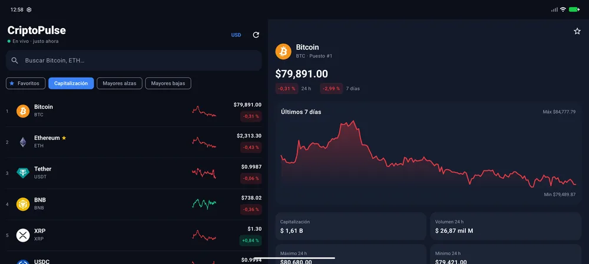

# CriptoPulse 📈

App Android de **precios de criptomonedas en tiempo real** con **caché offline**: muestra las 100
principales monedas de [CoinGecko](https://www.coingecko.com/), se actualiza sola cada minuto mientras
está en pantalla y, si no hay internet, sigue funcionando con los últimos precios guardados.


| Mercado en vivo | Detalle | Sin conexión |
|:---:|:---:|:---:|
|  |  |  |

**Diseño adaptable** — en tablets, plegables o en horizontal la lista y el detalle se ven lado a lado:



---

## Tabla de contenido

- [Qué problema resuelve](#qué-problema-resuelve)
- [Funcionalidades](#funcionalidades)
- [Stack tecnológico](#stack-tecnológico)
- [Arquitectura offline-first](#arquitectura-offline-first)
- [Estructura del proyecto](#estructura-del-proyecto)
- [Compilar y ejecutar](#compilar-y-ejecutar)
- [Pruebas](#pruebas)

## Qué problema resuelve

Seguir el mercado cripto desde el móvil suele depender de tener buena conexión. CriptoPulse guarda
cada actualización en una base de datos local: al abrir la app los precios aparecen al instante, se
refrescan en segundo plano y, sin internet, avisa claramente que los datos son de hace X minutos.

## Funcionalidades

- 🔴 **Precios en vivo** del top 100 por capitalización, con *sparkline* de 7 días por moneda.
- ⏱️ **Actualización automática cada 60 s** solo mientras la pantalla está visible (se detiene en
  segundo plano para no gastar batería ni cuota de la API).
- 📴 **Offline-first**: Room es la fuente única de verdad; banner con la antigüedad de los datos.
- ⭐ **Favoritos** persistentes (tabla propia, sobreviven a cada actualización del mercado).
- 🔎 **Búsqueda** por nombre o símbolo y **orden** por capitalización, mayores alzas o mayores bajas.
- 💱 **Moneda configurable** (USD, EUR, COP, MXN) guardada con **DataStore**.
- 📊 **Detalle** con gráfico de 7 días, variación 24 h / 7 d, capitalización, volumen, máx/mín 24 h,
  máximo histórico y circulante.
- 📱 **Diseño adaptable**: un panel en teléfonos, lista + detalle en pantallas ≥ 720 dp.

## Stack tecnológico

| Área | Tecnología |
|------|------------|
| Lenguaje | Kotlin 2.0, Coroutines, Flow (`combine`, `flatMapLatest`, `stateIn`) |
| UI | Jetpack Compose, Material 3, Navigation Compose, Canvas para gráficos |
| Arquitectura | Clean Architecture (data / domain / presentation) + MVVM |
| Inyección de dependencias | Hilt |
| Red | Retrofit 2 + OkHttp + kotlinx.serialization |
| Persistencia | Room (mercado + favoritos) y DataStore Preferences (moneda, última sincronización) |
| Imágenes | Coil |
| Pruebas | JUnit 4, kotlinx-coroutines-test |

## Arquitectura offline-first

```
              ┌──────────── presentation ─────────────┐
 MarketScreen ◄── StateFlow ── MarketViewModel ──┐     │
 CoinDetailScreen ◄── CoinDetailViewModel        │     │
              └──────────────────────────────────┼─────┘
                         casos de uso            ▼
              ┌────────────── domain ─────────────────┐
              │ FilterMarket · RefreshMarket ·        │
              │ ToggleFavorite · MarketRepository ·   │
              │ SettingsRepository (interfaces)       │
              └──────────────────┬────────────────────┘
                                 ▼
              ┌─────────────── data ──────────────────┐
              │ MarketRepositoryImpl ─► CoinGeckoApi  │
              │          │                            │
              │          └─► Room (coins, favorites)  │◄── la UI observa solo esto
              │ SettingsDataStore (DataStore)         │
              └───────────────────────────────────────┘
```

1. La UI **solo observa Room** (`Flow`), así que la primera pintura es inmediata con la caché.
2. `MarketViewModel` lanza un ciclo de refresco con `flatMapLatest` sobre la moneda elegida; al cambiar
   de moneda se cancela el ciclo anterior y se descarga de nuevo.
3. El estado se expone con `stateIn(WhileSubscribed(5 s))` y la pantalla lo recoge con
   `collectAsStateWithLifecycle`: en segundo plano no hay suscriptores y el sondeo se detiene.
4. Si la red falla, el error se muestra como banner y la lista sigue con los datos guardados.

## Estructura del proyecto

```
app/src/main/java/com/cordobot/criptopulse/
├── data/
│   ├── local/        MarketDatabase.kt (entidades, DAO)
│   ├── remote/       CoinGeckoApi.kt (+ DTOs)
│   ├── repository/   MarketRepositoryImpl.kt (+ mappers)
│   └── settings/     SettingsDataStore.kt
├── di/               AppModule.kt
├── domain/
│   ├── model/        Coin.kt
│   ├── repository/   Repositories.kt
│   └── usecase/      MarketUseCases.kt
└── presentation/
    ├── components/   Sparkline, ChangeChip
    ├── detail/       CoinDetail.kt
    ├── market/       MarketScreen.kt, MarketViewModel.kt
    ├── theme/        Theme.kt
    └── util/         Formatters.kt
```

## Compilar y ejecutar

Requisitos: Android Studio (Ladybug o superior), JDK 17, Android SDK 35. No necesita API key
(usa el plan público de CoinGecko, ~30 consultas/min).

```bash
./gradlew :app:assembleDebug
adb install -r app/build/outputs/apk/debug/app-debug.apk
```

## Pruebas

```bash
./gradlew :app:testDebugUnitTest
```

Cubren el orden y filtrado del mercado, el mapeo API → Room → dominio (incluido el *sparkline*), que la
hora de sincronización solo se guarde cuando el refresco tiene éxito y el formato de cifras en español.

---

Datos: [CoinGecko](https://www.coingecko.com/). No es asesoría financiera.

Desarrollado por **Adrián Alvarez** ([@Cordobot](https://github.com/Cordobot)).

© 2026 Adrián Alvarez. Todos los derechos reservados.
